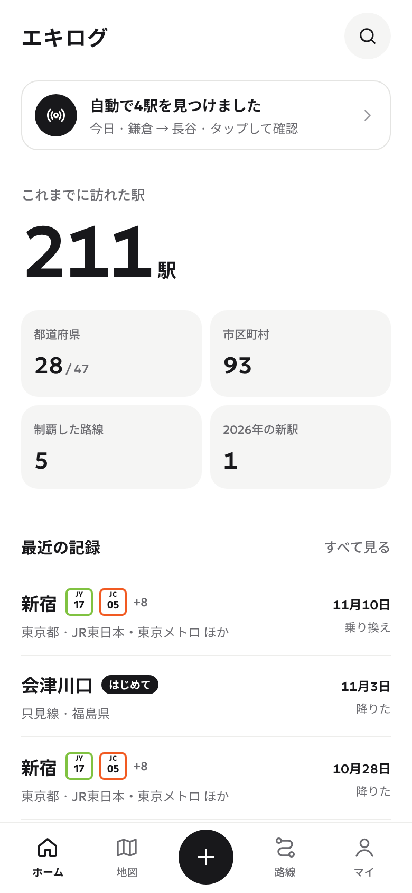
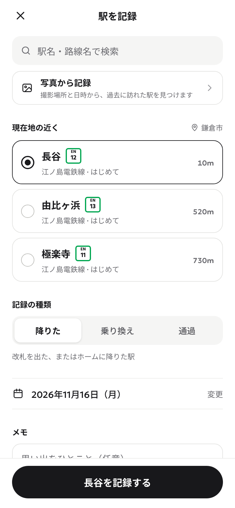
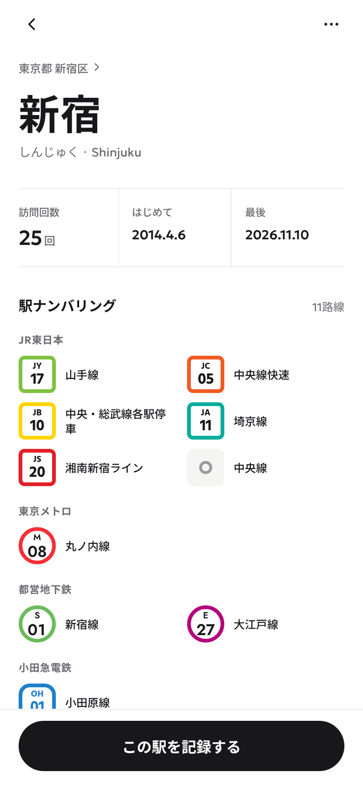
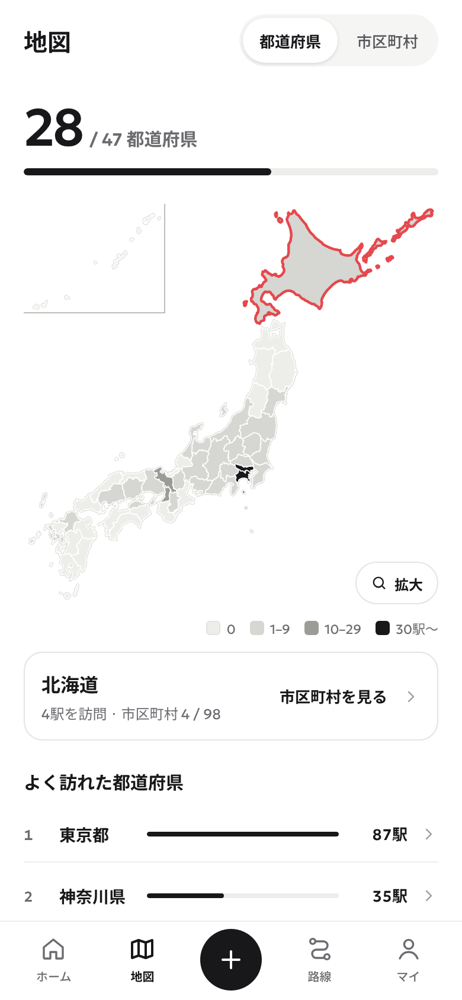
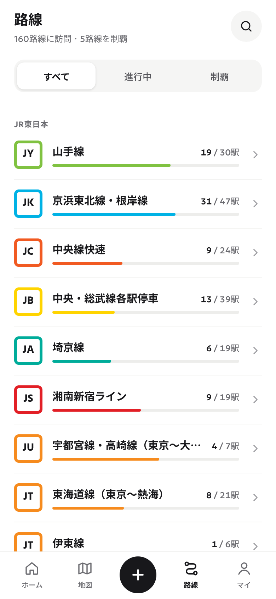
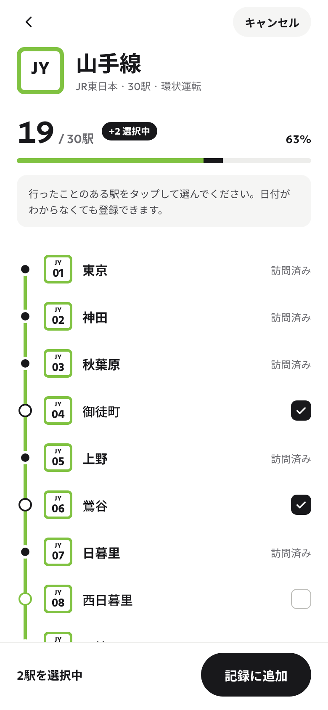
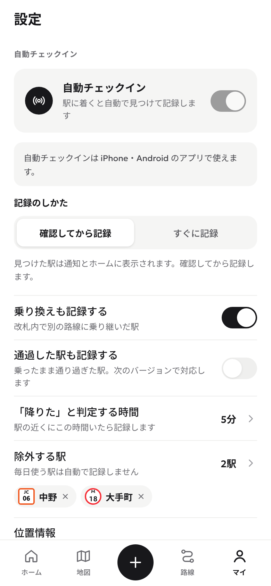
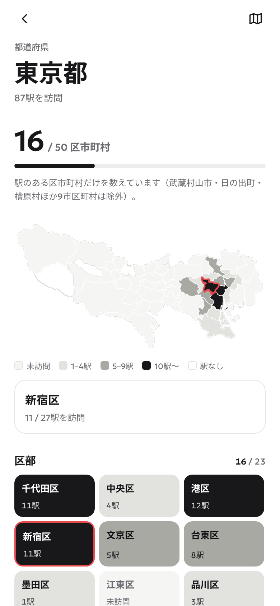

# エキログ

行った駅を記録して、日本地図・路線・市区町村が埋まっていくのを楽しむアプリです。
iPhone と Android の両方に、Expo（React Native＋TypeScript）の1つのコードから出します。

- 仕様：[docs/SPEC.md](docs/SPEC.md)
- 画面のデザイン：デザインキャンバス（SPEC.md 冒頭のリンク）
- 実装した画面：[docs/screenshots](docs/screenshots)

| ホーム | 駅を記録 | 駅の詳細 | 地図 |
| --- | --- | --- | --- |
|  |  |  |  |
| **路線** | **まとめて登録** | **設定** | **市区町村** |
|  |  |  |  |

## 動かす

```sh
npm install
npx expo run:ios        # iPhone（Mac と Xcode が必要）
npx expo run:android    # Android
npm run web             # ブラウザで画面だけ確かめる
```

Expo Go では動きません（バックグラウンドの位置情報と、同梱の SQLite を使うため）。開発ビルドで動かします。
クラウドでビルドするなら `npx eas-cli@latest build --profile development` です。

### Android の APK を作る

```sh
ANDROID_HOME=~/android-sdk JAVA_HOME=/usr/lib/jvm/java-17-openjdk-amd64 npm run build:apk
# → dist/ekilog-1.0.0-arm64-v8a.apk（約45MB）
```

- JDK 17 と Android SDK（`platforms;android-37.0`、`build-tools;37.0.0`、`ndk;27.1.12297006`）が必要です。
- 既定では arm64-v8a（いまの Android のほとんど）だけを入れます。古い 32bit の端末にも入れるなら `ARCHS=armeabi-v7a,arm64-v8a` を付けます。
- 署名はデバッグ用の鍵なので、そのまま端末に入れて試せますが、ストアには出せません。ストアに出すときは自分の鍵か EAS Build を使います。
- 端末に入れるには、APK を端末に送って開き、「提供元不明のアプリ」のインストールを許可します（`adb install dist/ekilog-1.0.0-arm64-v8a.apk` でも可）。

| コマンド | 内容 |
| --- | --- |
| `npm run typecheck` | 型チェック |
| `npm run lint` | lint |
| `npm test` | 単体テスト（Jest） |
| `npm run build:master` | 駅マスタを作り直す（`-- --map` で地図の形も） |
| `npm run build:apk` | Android の APK を作る（下を参照） |
| `npm run db:generate` | 記録DBのマイグレーションを作る |
| `maestro test e2e/` | 画面の流れのテスト（端末かシミュレーターが必要） |

`.claude/settings.json` のフックで、Claude Code がファイルを編集するたびに型チェックと lint が走ります。

## 構成

```
src/app/            画面（Expo Router）。(tabs) が下のタブ5つ
src/ui/             共通の部品（Text、NumberingBadge、地図など）
src/db/             記録DB（Drizzle）と集計のSQL
src/data/           駅マスタの読み込み、ナンバリングの表示スタイル表
src/auto/           自動チェックイン（判定・ジオフェンス・通知・バックグラウンドのタスク）
src/photos/         写真の撮影位置の読み取りと、駅の推定
scripts/build-master 駅マスタと地図データを作るスクリプト
data/               自前のデータ（ナンバリング、事業者名、読みがな、駅IDの台帳）
assets/db           同梱の駅マスタ（stations.db）
assets/map          日本地図・市区町村の地図（SVG のパス）
```

### データ

- **駅マスタ**（`assets/db/stations.db`、約1.4MB）は国土数値情報から作って同梱します。
  - 鉄道データ（N02、2025年度版）：9,046駅・607路線。300m以内の同名の駅（グループコード）を1駅にまとめるので、新宿は1駅で11路線です。
  - 行政区域（N03、2026年1月1日時点）：駅の座標から市区町村を割り当てます。駅のある市区町村は全国で1,404、東京都は50です。
  - 駅の並びは、N02 の線路の形をたどって決めます。
- **ナンバリング**は `data/numbering/lines.csv`（路線記号・色）と `segments.csv`（駅の並びと番号）に書きます。いまは19社・105路線、1,391駅です（JR東日本の首都圏、東京メトロ、都営、東急、西武、東武、京成、京急、小田急、京王、相鉄、横浜市営、京都市営、JR西日本の一部など）。並びを `起点>終点` で書けば、線路をたどって番号を振ります。
- **読みがな**は Wikidata（CC0）から取り、`data/readings.csv` に置いています。81%の駅にひらがな、99%にローマ字があります。
- **駅ID**はアプリ独自のもので、`data/station_ids.csv` が台帳です。N02 の駅コードは新駅ができるとずれるので、作り直すたびに「駅名と位置」で前回のIDに対応させます。駅マスタを更新しても記録は消えず、同じ駅を指し続けます。
- **記録DB**（`ekilog.db`）は端末の中だけにあり、駅マスタを `master` として ATTACH して1本のSQLで達成率を数えます。達成率は保存しません。

### 地図

日本地図と市区町村の地図は、行政区域（N03）の境界を mapshaper で簡略化して SVG のパスにしたものです（日本地図 75KB、拡大用 280KB、市区町村は47都道府県で 1.9MB）。
南西諸島は左上の枠に移しています。タップした場所の判定は自前で行い（`src/ui/maps/hitTest.ts`）、全画面の地図は指で動かしたり拡大したりできます。

### 自動チェックイン

1. OS のジオフェンスで、現在地に近い駅を見張ります（iPhone 19駅、Android 99駅＋外枠1つ）。外枠を抜けたら選び直します。
2. 駅に近づいたら、数分だけ細かく位置を取ります。
3. `src/auto/detector.ts` が判定します（5分以上とどまった→降りた、短く止まって別の路線へ出た→乗り換え、時速20km以上で通り過ぎた→通過）。除外する駅と、30分以内の再検知は記録しません。
4. 候補として保存し、ボタン付きの通知（記録する／乗り換え／記録しない）を出します。「すぐに記録」の設定なら確認なしで記録します。

MVP では仕様どおり「降りた・乗り換え」だけを自動で記録し、通過は v1.1 にしています（判定とテストはあります）。

## 仕様から変えたところ・決めたこと

- **ジオフェンスの円は 300m（地下駅 400m）**にしました。判定に使う「駅の近く」は仕様どおり 150m（地下駅 250m）です。円を判定より広くしないと駅に入る前の位置が取れず、乗り換えの判定に必要な「来た向き」がわからないためです。
- **日本語の書体**は Noto Sans JP を JIS 第1・第2水準と駅名・画面の文字に絞って同梱しています（1つの太さで 5.6MB → 2.2MB）。入っていない文字は端末の日本語フォントで出ます（`scripts/fonts/subset-jp.py`）。
- **ブラウザ版**（`npm run web`）は画面の確認用です。SQLite は sql.js で動かし、記録はブラウザに保存します。自動チェックインと通知は動きません。
- 自動チェックインを使うときは、許可を求める前に説明を出します。「使用中のみ」のときは理由と設定アプリへの案内を出します。許可がなくても他の機能はすべて使えます。
- 写真は写真ライブラリのIDだけを持ちます。IDが取れない写真だけアプリ内にコピーします。

## 実機での確認（まだ）

この環境には iPhone・Android の実機もシミュレーターもないため、次は実機で確かめる必要があります（docs/SPEC.md 9章）。

- [ ] 位置情報が「使用中のみ」のとき、自動チェックインが使えない理由を説明し、設定へ案内する
- [ ] アプリを閉じた状態で駅に着き、通知が届く（iPhone・Android）
- [ ] 通知のボタンで記録でき、アプリを開くと反映されている
- [ ] 地下駅と圏外の駅で記録できる
- [ ] 自動チェックインをオンにした日とオフの日で、電池の減りを比べる
- [ ] 写真の権限を「選んだ写真のみ」にしても、写真から記録が使える
- [x] 「データの出典」画面に国土数値情報の出典が出ている
- [ ] ナンバリングの表示を、各社の公式資料と見比べる
- [ ] `maestro test e2e/` を通す

## 未決事項（SPEC.md 10章から）

- ナンバリングCSV の残りの事業者（Osaka Metro、名古屋市営、近鉄・阪急・阪神・京阪・名鉄など）と、各社の利用条件
- 機種変更のときの引き継ぎ（書き出し・バックアップ）
- 収益化の方法
- ライブアクティビティ・常駐通知（v1.1）、振り返り・共有（v2）
